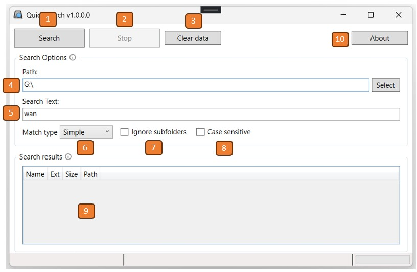

# QuickSearch
Search files on your drive without indexing.

## Introduction
I never liked having an indexing service running in background. However, without it, Explorer search gets extremely long.

So I wrote this application to solve the issue. It is just searching the wanted text in the name of files and directories.

## Usage
There is only one dialog, which looks as shown in the picture below.

Components

1. Search button: to start the search.
2. Stop button: stop a running search.
3. Clear button: erase all the editable fields.
4. Search path: the path where to start the search from. You can use the *Select* button to select the folder, or you can enter it directly.
5. Search text: the search string to find. Depending on the *Match Type*.
6. Match type: the way *Search text* is mathced.
	* Simple: just a substring search. A file/directory is matched if the name contains the string.
	* Wildcards: the search string can contain wildcards (i.e. `*`, `?`). e.g. `ciccio*.tx?`
	* RegEx:the search text is considered a regular expression.
7. Ignore subfolders: if this is checked, on the selected folder is examined, subfolders won't be
8. Case sensitive: if selected the match will be case sensitive. By default it is case unsensitive.
9. Search results: here you can find the matching files. Double clicking on a file will open an Explorer window with that file selected.
10. About button: shows a dialog with the info of the software.

> [!Note]
> If the match is simple, the string is not checked for the presence of wildcards or invalid characters, so you will get zero matches.

### Operation
The operation is super simple.
* Select the root folder where to start the search from.
* Select the *Match type*
* Enter the text you want to search in the *Search Text* edit.
* Press *Start*

> [!Note]
> The data in the fields/checkboxes are saven when *Start* button is pressed. *Clear* button will also erase any saved data.

## Todo
The software is pretty much complete, just some refinements are missing.

- [ ] Write more helpful error messages
- [ ] Check the *Search text* when the match type is set to *Simple*
- [ ] \(Optional) Add other languages

### Donation

If you find this software useful, or it helped you to save time, you can buy me a coffee.

**Bitcoin**: `bc1q4379vq6jfg8swgqajyaetm02fyk2mwj0mwy8wj`

**Ethereum**: `0x381C29dE5781EEa0182568146a1B2c32205DF85B`

**DogeCoin**: `DGbL57EA844QzgqRc1Z9kXLJKj261J138i`

